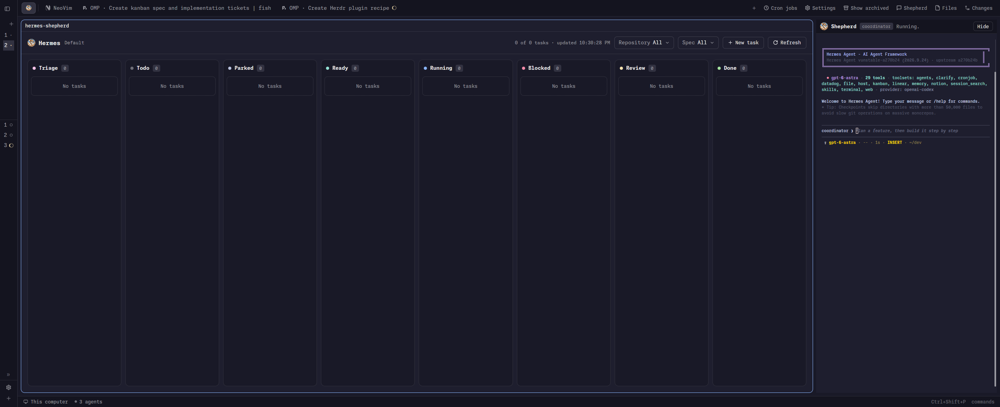

# Hermes Shepherd

Build a Herdr App mod that shows a live Hermes kanban board in an ordinary tab. People can read task history, edit Triage descriptions, comment, create tasks and use Hermes's task actions. An optional layout panel keeps their Hermes coordinator beside every tab. Use the person's Herdr theme rather than a fixed palette.



## What you see

The board fills its tab. Its toolbar has a 20px logo and a 15px semibold Hermes title, the board name, a fallback notice when needed, the task count and last successful read time, Repository and Spec filters, New task and Refresh. Cron jobs, Settings, Show archived and Shepherd appear at the top right through herdr-navigation, not again in the toolbar.

Below the toolbar, show these columns in Hermes's workflow order: Triage, Todo, Parked, Ready, Running, Blocked, Review and Done. Parked is Hermes's `scheduled` status, not a timer. Include every non-archived task, including all of Done.

Columns share the width but remain at least 236px wide, with 10px gaps and 16px board side padding. Each has a 42px header with a status dot, title and count. Use rounded 10px column borders and rounded 8px cards. Each column scrolls vertically; the board scrolls horizontally when its columns do not fit. A vertical wheel over cards scrolls that column, not the board. Empty columns say No tasks.

Each card shows an 8px status dot, task ID, profile initials, an actions button, a 13px medium-weight title, optional spec and repository chips, and the assigned profile or Unassigned. Unassigned has an empty dashed avatar. Parked cards show their reason. Blocked cards have a warning-colored border and an Unblock button. Running cards have a Running chip and pulse from 0.6 to 1 opacity over 1600ms. A selected card has an accent border; hover strengthens other borders.

Use theme colors for background, canvas, chrome, borders, foreground, muted text, hover and selection. Status markers use `ansi5` for Triage, `idle` for Todo, `ansi7` for Parked, `ansi6` for Ready, `ansi4` for Running, `blocked` for Blocked, `ansi3` for Review and `ansi2` for Done. Use Geist Mono for IDs, board names and counts. Most secondary text is 11–12px. Status names accompany color wherever a status chip appears.

A failed read adds an error banner and Retry button without removing the last successful board.

A task opens in a modal dialog, 1200px wide and 85% of the window height. Its side column shows status, profile, spec, repository, workspace, priority, dates and parent and child tasks. Its main area has Details, Events, Runs, History and a configurable records tab, initially Links. Render descriptions, results, comments and run summaries as Markdown. Give pipe-delimited Markdown tables their own horizontal scroll area.

Other overlays provide filter pickers, New task, Settings, task actions, confirmations, archived tasks and a read-only cron list. The cron list shows every profile's jobs with schedule, state, next run and last result or error.

The optional Shepherd panel has a 36px header over a terminal. Start with a 460px width and limits of 280–1100px. The header shows the coordinator's state, its profile, exit information and the appropriate Start, Restart, Restore panel or Hide controls.

## How it behaves

### Board selection and navigation

Match the tab name to a Hermes board's slug or display name, ignoring case. An unnamed or unmatched tab reads the default board. Show a notice for an unmatched name. Renaming the tab switches boards; never create a board as a side effect.

Repository and Spec filters offer All, None and exact values. Repository comes only from a native `dir` workspace; Spec comes only from `tenant`. Persist filters globally across Shepherd tabs and App restarts.

Refresh on board-folder changes and every 30 seconds. Keep an open task dialog synchronized with the board too.

- Arrow keys select cards. Enter opens the selected task, and `m` opens its actions.
- `n` opens New task, `r` opens Repository, `s` opens Spec and F5 refreshes.
- Escape clears board selection or dismisses an overlay.
- Filter pickers support arrows and Enter.
- Left and Right switch task detail tabs. In records, Up and Down select a record and Enter launches it.

These are Hermes task states, not Herdr agent states. Do not map Herdr's working, blocked, done or idle agent signals onto board columns. The coordinator is a real Core terminal, so Herdr handles its terminal and agent presentation.

### Task edits and actions

Allow description editing only while the task is in Triage. Save rechecks both status and the description version. Refuse a stale write and keep the draft. Persist drafts by board and task across dialog closes until saved or discarded. A draft becomes read-only if the task leaves Triage. Archived tasks are read-only.

Allow comments on tasks that are neither Done nor archived. Submit with Comment or Ctrl+Enter, use author `user`, and recheck eligibility before writing. Keep a refused comment in the open dialog, but do not persist it after closing.

New task asks for a title and optional Markdown description. Enter in the title, Ctrl+Enter in the description or Add to Triage creates it on the selected board with creator `user`.

Triage actions offer Send to Todo and Send to Ready without confirmation. Blocked tasks offer Unblock without confirmation. Let Hermes enforce parent dependencies and report the actual resulting state rather than assuming the requested state won.

Archive asks first and explains worker termination, workspace cleanup and the possibility of releasing children. Archived tasks remain readable. Restore asks first and returns a task to Triage, not its former state. Warn that restoring unfinished work resets affected descendants to Todo and stops their workers. Permanent deletion applies only to archived tasks, asks first, and must not accept Enter as confirmation.

Every status action sends the status the person saw. Refuse if it changed, and show the current task.

### Records and settings

Settings edits the coordinator profile, records tab name and an ordered list of rules. Each rule contains a Python regex, command, description and Open in new tab switch, initially on. Validate the entire draft before saving anything. Ask before discarding unsaved Settings changes. Persist settings globally.

Match rules against descriptions, results, comments and run summaries, without altering the displayed source text. The earliest match wins; the first rule wins ties. Resume after the match and deduplicate records with identical command arguments and description.

Support `$0` for the whole match, numbered capture groups and `$$` for a literal dollar. Split command templates into arguments before inserting captures. Captures remain literal text inside an argument. Refuse launch if a capture used in a command starts with `-`, even inside a longer argument.

Each click starts a fresh command in the selected space's folder. Open a new tab when requested; otherwise run in the background. Report missing programs and commands that exit within a second, including their exit information and last output.

Run matching outside the UI process. Stop an attempt after 3 seconds, identify and skip the rule that consumed most of that time, and retry other rules. Stop retries after 15 seconds total. If no rule accounts for most of the timeout, report that the task is too large. Match again only when rules or task text change. Show records in batches of 300 with Show more.

In Settings, Up and Down select a rule and Enter edits it. Alt+Shift+Up and Alt+Shift+Down reorder it, Alt+T toggles its new-tab setting, and Alt+Shift+Backspace removes it. These shortcuts also work while editing a rule.

### Coordinator panel

Keep one Core terminal named `hermes-shepherd` for all tabs and spaces. When the panel becomes visible, attach to that terminal or start it in the person's home folder. Run `hermes -p coordinator` unless Settings saved another valid profile. Never create a profile or change Hermes settings.

Keep a shell runner alive after Hermes exits. Show its exit code and last line; restart only on Enter or Restart. Hiding the panel, changing tabs and restarting the App must not stop the conversation. A profile change applies at the next start, never by interrupting a live conversation. Show both saved and running profiles when they differ.

The Shepherd button and Hide use the layout's panel visibility. A global shortcut may use `layout.toggle:shepherd`. Where the installed App supports it, pass `focus: "shepherd-terminal"` to open and focus the panel, focus a visible panel without hiding it, and hide it when already focused.

If the terminal block disappears, Restore panel adds only that block back to the existing personal layout column. Preserve the rest of the layout and reuse a live coordinator. Do not silently replace a layout or edit a shipped layout.

## Built from

Use these files as the implementation reference:

- `mods/hermes-shepherd/main.js` contains the UI and embedded icon art.
- `mods/hermes-shepherd/mod.json` declares `{"place":"none","title":"Hermes Shepherd"}`.
- `board/hermes_shepherd_board.py` provides board reads, task details, edits, comments, creation, actions, rule validation and bounded matching as JSON commands.
- `board/hermes_shepherd_cron.py` reads jobs across profiles as JSON.
- `home-manager.nix` installs the mod and wraps both helpers with the configured Hermes Python.

Use one default-exported gpui-kit `View`. No props shows the board; `panel` shows the coordinator header. Overlay props route `menu`, `cron`, `task`, `settings`, `actions`, `confirm`, `archived` and `create` to their views. Use gpui-base inputs, text areas, Markdown and scrollbars rather than a web view.

Use Herdr's `spaces`, `panes`, `terminals`, `focused` and `layout` for context; `theme` and `settings` for appearance; `shared` and `setShared` for persisted filters, settings and drafts; `openOverlay` and `closeOverlay` for dialogs; `nextCommand` for tab-control commands; `watchFolder` and view timers for refresh; `exec` for helper processes; and `hc` and `run` for Core and App operations. Do not retain a callback's `cx`.

Publish top-right controls through `shared("tab-controls:hermes-shepherd")` for herdr-navigation. Use the `hermes-shepherd.filters`, `hermes-shepherd.sessions` and `hermes-shepherd.drafts` shared keys for the mod's state.

Install `hermes-shepherd-board` and `hermes-shepherd-cron` on the App's PATH. Both must use the interpreter that imports the installed `hermes_cli`. The board helper's module docstring defines its flags and JSON error contract. Exit 1 reports errors; refused description edits and status actions exit 2 with current task details.

Read the installed Hermes source before rebuilding the helper. Use Hermes's own create, edit, comment, archive, unblock and archived-delete functions. For moves and restores, use the dashboard's `plugin_api.update_task` so dependency gates, descendant resets and worker termination remain intact. Never write board SQL or set statuses directly. Re-read after every write.

The optional panel is this subtree in a personal layout, usually beside Files and Changes:

```json
{
  "id": "shepherd",
  "type": "column",
  "hidden": true,
  "size": { "px": 460 },
  "min": 280,
  "max": 1100,
  "children": [
    {
      "id": "shepherd-bar",
      "type": "block",
      "size": { "px": 36 },
      "content": { "mod": "hermes-shepherd", "props": { "panel": true } }
    },
    {
      "id": "shepherd-terminal",
      "type": "block",
      "content": { "terminal": "hermes-shepherd" }
    }
  ]
}
```

Keep the `shepherd` and `shepherd-terminal` IDs and terminal name. Other sizes and placement are personal choices. No shipped layout or shipped mod clone is bundled with this mod.

Write embedded SVG icons and the full-color logo to real files in the writable mod folder before drawing them. Keep the icon generation exception at module scope; keep instance state and other host calls in view initialization. Store the saved coordinator profile in the hidden `.profile` file so updating it does not trigger a reload.

Launch record commands through Core as `hc run ... -- env -- <argv>`, without a shell. The coordinator deliberately uses `sh` to keep its terminal alive and passes the profile as one argument after `-p`.

## Watch out

This mod runs programs and reads files outside its own folder. Disclose that before installation. It reads Hermes boards and profile cron data, writes task changes through Hermes, writes icon and profile files, and launches user-defined record commands and the coordinator through Core. The mod adds no sandbox. Programs and their wrappers determine network access, jail boundaries and approvals. In an agent jail, verification commands must follow the jail's process rules too.

The board and cron views need an existing Hermes installation and board, not a gateway or coordinator profile. The panel additionally needs `hermes`, `hc` and `sh` on Core's PATH and an existing configured profile. Herdr-navigation is needed for the top-right controls. Without it, Settings remains reachable from Edit rules, but cron and archive lists have no entry point.

Opening a board may run Hermes schema migrations. The cron helper skips profiles without a jobs file, but Hermes's own job reader can rewrite an existing file. Do not promise read-only filesystem access.

Hermes exposes no atomic compare-and-set for these operations. A status or description change between the freshness check and write can still pass. Preserve that warning and the post-save warning if a task left Triage. Hermes's gateway may auto-decompose Triage tasks, rewrite their text and move them to Todo.

Archiving may release child tasks and start work. Restoring may reset descendants and stop workers. Hermes's archived deletion can leave attachment rows and files behind. Do not promise that deletion removes attachments.

Hermes has no complete change feed. Database writes can stay in a WAL, so folder watching alone is insufficient; keep the 30-second poll. Do not infer repository or spec metadata from text or unrelated workspace types.

Only Markdown tables with rows beginning with `|` receive the separate horizontal scroll treatment. There is no drag-and-drop status move, cron editing or automatic coordinator restart.

Home Manager installs source symlinks, but Herdr image rendering needs real asset files. Wait for icon writes before rendering them; a cached missing image can require an App restart. Hidden profile files avoid hot reload. A broken source reload can leave the last good build visible, so inspect App status rather than trusting the screen alone.

Find the coordinator by name, never a cached terminal address. Core reuses addresses. Panel repair requires a personal layout and must preserve unrelated nodes. Terminal-block removal varies by App version; exercise recovery on the installed version.

For Nix-managed setups, declare persistent installation, layout and key changes in Nix. Preserve managed symlinks. Treat activation as a separate approved step, not something the recipe has already performed.

## Done when

- Run `"$HERMES_PYTHON" -m unittest discover tests` against the installed Hermes package. Use temporary Hermes homes and strip inherited board-resolution overrides.
- Run `node --test tests/panel.test.mjs` to verify panel recovery preserves other layout nodes and live conversations and reports refused layout edits.
- Run `herdr-app check` on the installed mod, then exercise it in a private App and Core with an isolated Hermes home. A passing load check alone does not prove layout or later async states.
- Seed the private board with `tests/seed_board.py`. Verify columns, empty states, narrow-window scrolling, running animation, filters, keyboard navigation and the read-error banner.
- Rename the board tab and verify board matching and default fallback. Change the board externally and observe both the board and an open task refresh.
- Create a task, edit its Triage description, exercise a stale-save refusal, add a comment and verify Done and archived tasks reject comments. Confirm drafts survive dialog closes.
- Exercise dependency refusal, Unblock, Archive, Restore and permanent deletion against disposable tasks. Verify the actual resulting states and confirmation behavior.
- Verify Markdown table scrolling, combined history, rule ordering, literal capture insertion, leading-dash refusal, bounded regex matching and record launch failures. Verify new-tab and background launches in the selected space.
- Show the panel, hide it, switch spaces and reopen it without starting another coordinator. Exit Hermes, confirm no automatic restart, then restart deliberately. Save another profile and confirm it applies only at the next start. Remove the disposable panel terminal block and restore it without disturbing the layout.
- Inspect `herdr-app status` for load errors and inspect a `herdr-app shot` of the running mod. Save a representative board screenshot as `preview.png` before publishing.
